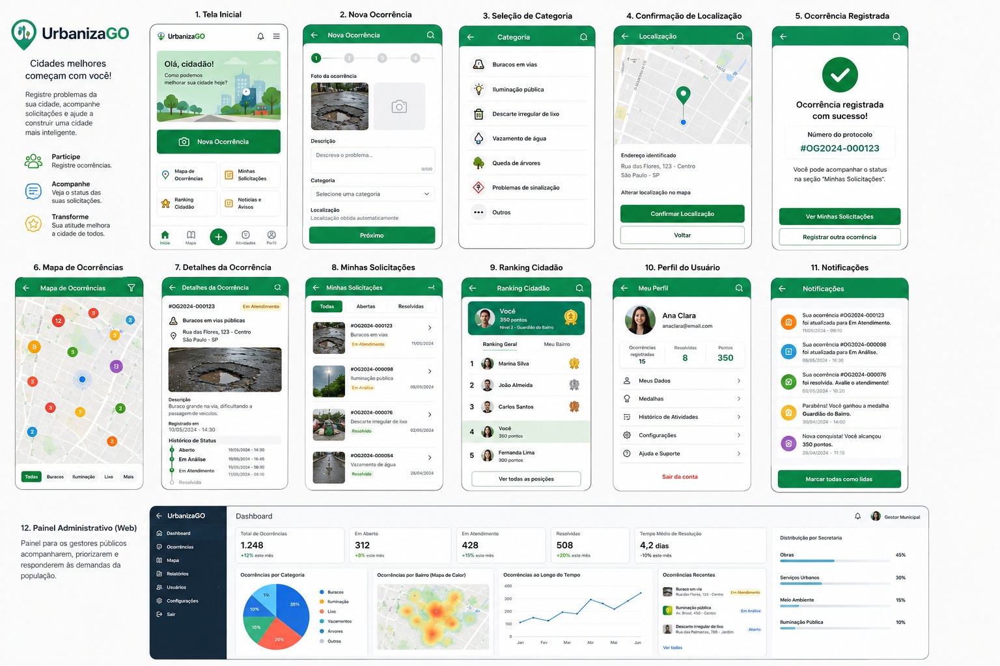
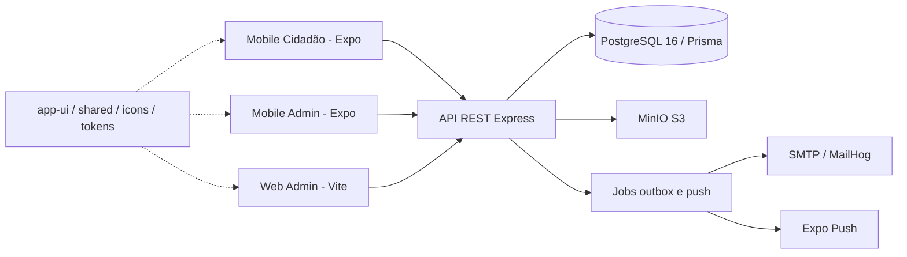

# UrbanizaGO

**Plataforma colaborativa para cidades inteligentes** — versão 1.0.0 (candidata a homologação).

Cidadãos registram ocorrências urbanas com fotos, descrição e localização; gestores municipais analisam, priorizam, distribuem e acompanham a resolução. O monorepo reúne três interfaces reais, API REST, PostgreSQL, armazenamento de fotos, e-mail e documentação. Não é necessário aplicar entregas ou patches anteriores.



## Início rápido — Windows

Pré-requisitos: Git, Node.js **22 LTS**, npm, Docker Desktop com Docker Compose v2 em execução. Para mobile, Android Studio com emulador ou dispositivo físico. A primeira instalação exige internet para pacotes e imagens Docker.

Abra um terminal PowerShell na pasta que contém este README:

```powershell
Copy-Item .env.example .env
docker compose up --build -d
docker compose ps
docker compose logs -f api
```

A API executa migrations, seed e criação do bucket na inicialização. Aguarde o healthcheck indicar serviço saudável. `Ctrl+C` sai dos logs, sem desligar os containers.

| Serviço | URL / porta |
|---|---|
| Painel Web Admin | http://localhost:5173 |
| API REST | http://localhost:3000/api/v1 |
| Health | http://localhost:3000/health |
| Swagger UI | http://localhost:3000/docs |
| MailHog (e-mails locais) | http://localhost:8025 |
| Console MinIO | http://localhost:9001 |
| PostgreSQL (local) | localhost:5432 |

Credenciais seed **somente para desenvolvimento**:

| Conta | E-mail | Senha |
|---|---|---|
| Administrador | `admin@urbanizago.local` | `UrbanizaGO-dev-2026!` |
| Cidadão | `cidadao@urbanizago.local` | `Cidadao-dev-2026!` |

MinIO: `urbanizago` / `urbanizago_dev_only`. PostgreSQL: usuário e banco `urbanizago`, senha `urbanizago_dev_only`. O seed de demonstração configura destinatário `obras@urbanizago.local` para buracos, sem enviar dados reais para fora do MailHog. Não há ocorrências fictícias por padrão: registre uma para ver o dashboard mudar.

## Mobile: instalar e iniciar

Com o Docker ativo, instale as dependências do monorepo na raiz:

```powershell
npm install
Copy-Item apps/mobile-citizen/.env.example apps/mobile-citizen/.env.local
Copy-Item apps/mobile-admin/.env.example apps/mobile-admin/.env.local
```

Emulador Android: `EXPO_PUBLIC_API_URL=http://10.0.2.2:3000` (já pré-configurado). Celular físico: substitua em cada `.env.local` por `http://IP_DO_SEU_PC:3000` (obtenha o IPv4 com `ipconfig`, use a mesma rede e permita acesso à porta 3000 no firewall). iOS simulator: `http://localhost:3000`.

Terminais separados, a partir da raiz:

```powershell
npm run dev:citizen
npm run dev:admin
```

Portas Metro: 8081 (cidadão) e 8082 (administrador). O SDK 54 exige runtime compatível. Para **build de desenvolvimento Android**, execute dentro de cada pasta `apps/mobile-...`: `npx expo install --fix`, `npx expo run:android`, depois `npx expo start --dev-client --port 8081` (cidadão) ou `8082` (admin). Requer Android SDK, JDK e emulador configurados; rode um build por vez se houver conflito de porta. O Expo Go compatível serve para fluxos básicos, mas push remoto e mapas com configuração nativa exigem development build. Leia [guia mobile](docs/guia-mobile.md).

Mapas Google exigem chaves próprias com faturamento habilitado: `VITE_GOOGLE_MAPS_API_KEY` no `.env` da raiz (recrie web: `docker compose up -d --build web-admin`), `EXPO_PUBLIC_GOOGLE_MAPS_API_KEY` em cada `.env.local` (recompile o app). Configure Maps JavaScript API, Maps SDK for Android/iOS e restrições. Sem chave, telas de lista, GPS, endereço manual e link externo continuam disponíveis; o mapa embutido mostra aviso. Push remoto exige projeto EAS e credenciais de push — veja o guia. SMTP local funciona sem conta externa.

## Teste de fumaça

Depois que o ambiente estiver saudável:

```powershell
node scripts/smoke.mjs
```

O teste cria **um** cidadão e uma ocorrência de teste, valida pelo admin, resolve, avalia e consulta o saldo. Requer seed e MailHog. Não execute em produção. A execução deste teste no ambiente do usuário é necessária para homologação; não foi executada no ambiente gerador.

## Rodar fora dos containers / hot reload

```powershell
# Infraestrutura apenas
docker compose up -d postgres minio mailhog
npm install
npm run db:generate
npm run db:migrate
npm run db:seed:dev
npm run dev
```

A API usa `.env` da raiz, com `DATABASE_URL` e hosts locais. Não mantenha API/web do Docker nas mesmas portas. Alternativa: `docker compose -f docker-compose.yml -f docker-compose.dev.yml up --build`. O hot reload monta os arquivos de código; ao alterar dependências, reconstrua as imagens.

## Arquitetura



```
apps/api/          Backend, Prisma, migrations, seed, jobs e rotas
apps/web-admin/    Adaptador web, React Router, gráficos Recharts e Google Maps
apps/mobile-admin/ Aplicativo Expo para gestores
apps/mobile-citizen/ Aplicativo Expo para cidadãos
packages/app-ui/   Telas e componentes compartilhados (React Native / RN Web)
packages/shared/   Cliente REST, tipos e schemas comuns
packages/icons/    Ícones SVG próprios
packages/ui-tokens/ Design tokens
scripts/           Teste de fumaça e utilitários
docs/              Documentação funcional e técnica
docker/            Configuração Nginx
```

## Scripts npm

`dev`, `dev:api`, `dev:web`, `dev:citizen`, `dev:admin`, `build`, `typecheck`, `lint`, `format`, `db:generate`, `db:migrate`, `db:seed`, `db:seed:dev`, `docker:up`, `docker:down` e `test:smoke`. `build` compila API/web e gera bundles Android dos apps, não APKs assinados.

