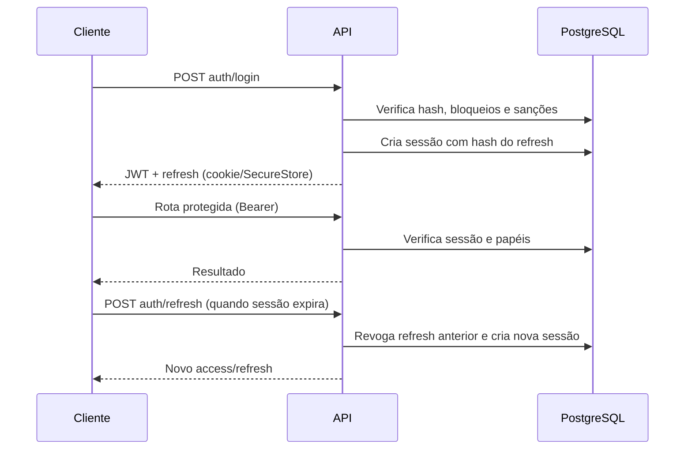
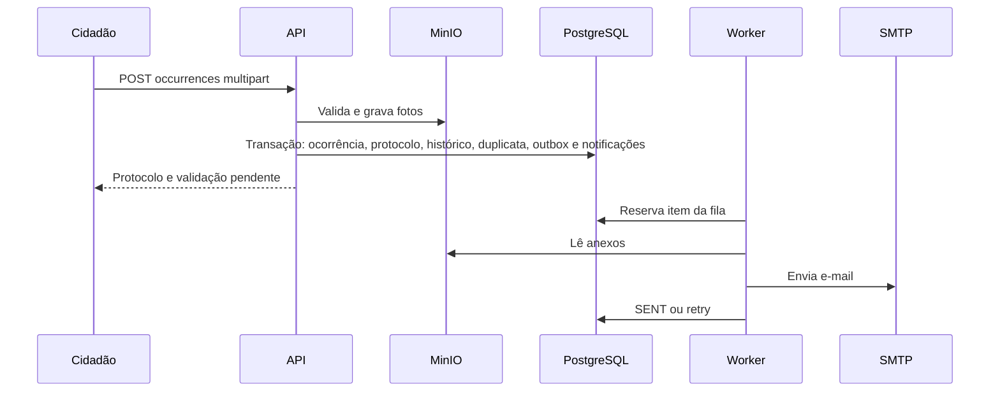
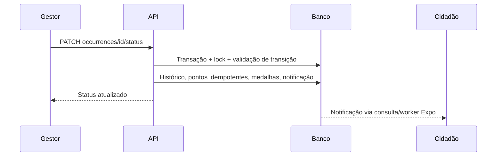

# Fluxos principais

## Login e refresh

## Ocorrência e e-mail

## Status e pontos

## Exclusão de conta
Senha → código único enviado por e-mail → senha + código → anonimização em transação → revogação de sessões → e-mail de conclusão. Sem período de arrependimento. Dados remanescentes e considerações legais: [LGPD](lgpd.md).
