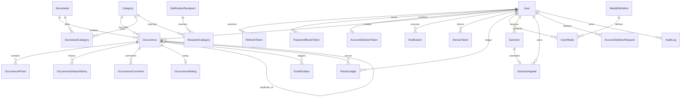

# PostgreSQL e Prisma

Fonte de verdade: `apps/api/prisma/schema.prisma`; migrations SQL versionadas em `apps/api/prisma/migrations`; seed idempotente em `apps/api/src/seed.ts`. PostgreSQL 16. IDs UUID gerados pelo Prisma, datas UTC, protocolo derivado da sequência global. A tabela de ocorrências contém índices para categoria/status/bairro/data/lat-long; vínculos de categorias e secretarias são muitos-para-muitos por tabelas de junção. Soft deletion para usuário via anonimização, categorias/secretarias/avisos via `active`. As migrations são aplicadas por `prisma migrate deploy` no start Docker.



Outras tabelas: `BannedEmailHash` (hash do e-mail banido), `Setting` (parâmetros configuráveis) e `Announcement` (avisos publicados). `EmailOutbox` guarda status, lease, tentativas, erro e datas; `Notification` inclui campos de push/retry. Chaves `eventKey`, `protocol`, `email`, vínculo de recurso e medalha+usuário garantem unicidade. Não alterar migration aplicada; criar nova.

```powershell
npm run db:generate
npm run db:migrate
npm run db:seed:dev
```

Para mudanças locais: com o DB de desenvolvimento ativo, `npm exec -w @urbanizago/api -- prisma migrate dev --name nome`, com `DATABASE_URL` exportada para o shell (o wrapper `node scripts/prisma.cjs` carrega `.env` raiz). Versione `.sql` e schema juntos. Não execute `migrate dev` em produção.
